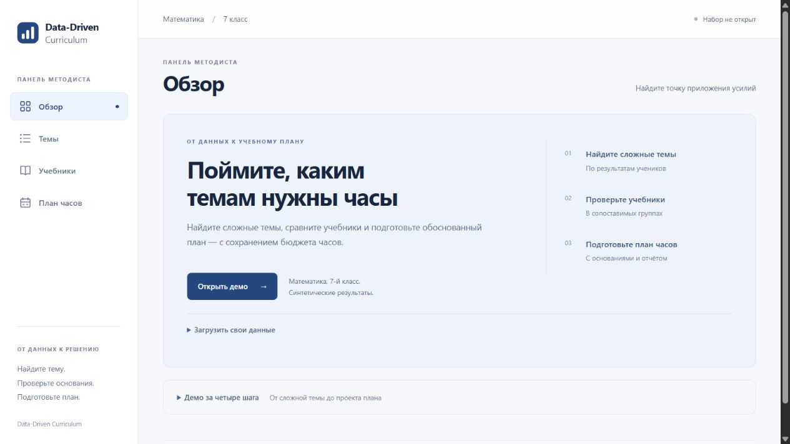
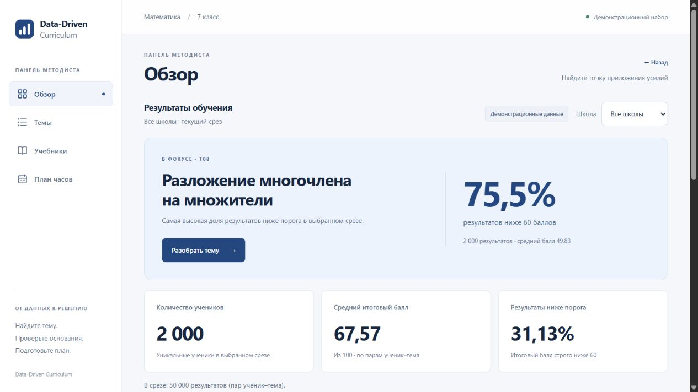
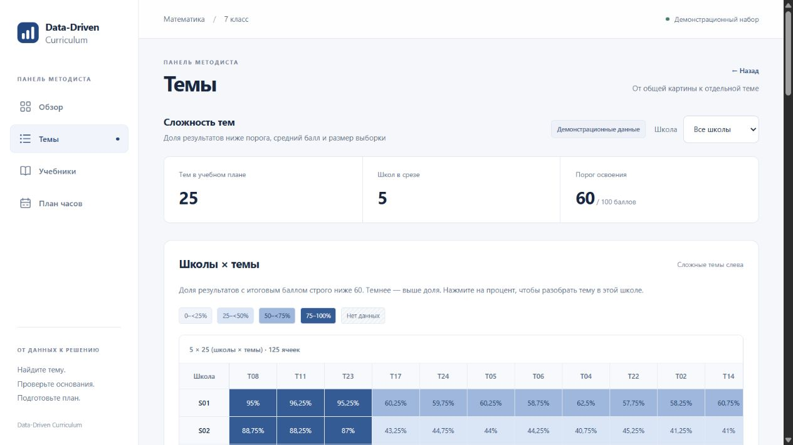
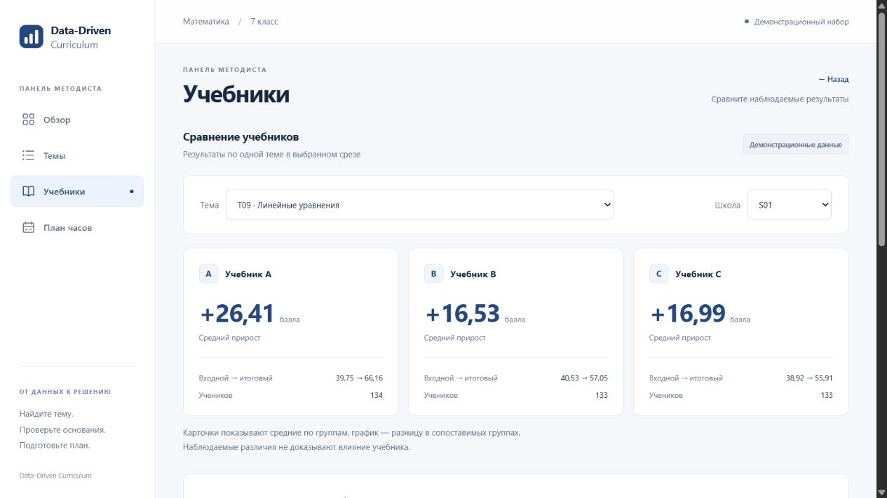
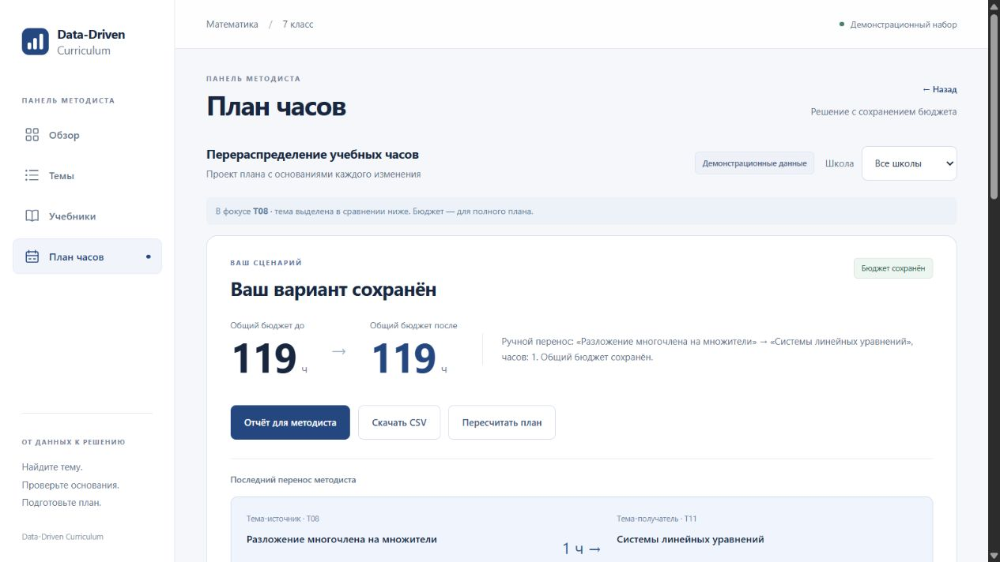
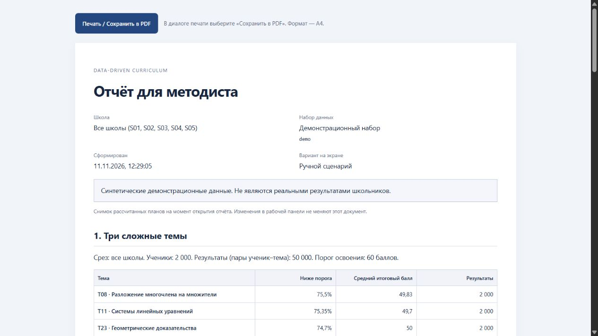
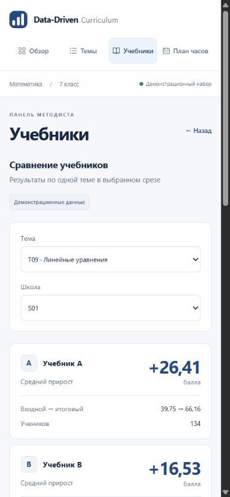

# Единая система интерфейса

Редизайн на основе emil-design-eng. База — main d8794f4, ветка — feat/design-system. Изменения только в frontend/, API и расчёты сохранены. Без новых зависимостей.

| Before | After | Why |
| --- | --- | --- |
| Основные стили и несколько перекрывающих слоёв | Общий design-system.css, отдельные стили графика и документа | Одни цвета, типографика, поля, кнопки и таблицы для всего приложения |
| Подсветка строк через keyframes 1,3 с | Постоянные отметки и мгновенная смена данных | Аналитика и частые действия не должны ждать анимацию |
| У нажатия только изменение цвета | scale(.98), 140 мс, cubic-bezier(.23, 1, .32, 1), только для указателя | Короткий отклик без изменения размеров макета |
| Одинаковое поведение мыши и клавиатуры | InputMode отключает переходы для клавиатурного ввода | Enter и навигация с клавиатуры мгновенны; фокус сохраняется |
| Размеры групп в графике скрыты до hover | Числа видны постоянно, нажатие выделяет пару | Одни и те же данные доступны на телефоне и с клавиатуры |
| В учебниках сначала подробные таблицы | Карточки прироста, наблюдаемое сравнение, раскрываемые таблицы | Сначала результат и его смысл, затем детали |

## Структура и движение

Токены цвета, радиуса и кривой находятся в :root. Обычный CSS, нативные select/details и семантические таблицы. У каждого экрана общая шапка и согласованный следующий шаг. Обновлены старт, обзор, темы, разбор темы, учебники, план, формы, квитанция загрузки, пустые/ошибочные состояния и отчёт.

У частых действий (переключение вкладок, выбор школы/темы, обновление таблиц) анимации нет. Единственное движение — отклик на нажатие указателем. Состояние клавиатурного ввода определяется до обработки действия; длительность переходов равна нулю. Hover ограничен устройствами с hover и точным указателем. Reduced motion убирает перемещение и переходы, сохраняя статические состояния. Размеры данных и графики не анимируются.

## Проверки

- npm run build — успешно; npm test — 28/28.
- Живой API в браузере: демо — 2000 учеников; S01 — 400; сброс — 2000.
- Карта — 5 школ × 25 тем; нажатие T08/S01 открывает разбор с 400 результатами. Далее работают выбор T09/T19 и сброс школы в учебниках.
- Для всех школ перенос T08 → T11 на 1 час: 7 → 6 и 7 → 8; CSV содержит 25 тем и сумму 119. В отчёте бюджеты 119 / 119 / 119.
- На мобильном срезе S01 используются его реальные автоматические часы: T08 5 → 4, T11 7 → 8, бюджет 119. Значения не подменяются цифрами общего среза.
- Загрузка файлов генератора: 2000 учеников, 5 школ, 25 тем, 50000 результатов. Некорректный CSV показывает results.csv и строку 1; ранее открытый набор сохраняется.
- CSS viewport 390 × 844: все четыре вкладки, карта, разбор, сравнение, ручной перенос; ширина страницы не превышает viewport, широкие таблицы прокручиваются отдельно.
- Enter раскрывает причину переноса; видимый фокус и transition-duration: 0s. Возврат браузера из плана восстанавливает учебники T09 и S01.
- Отчёт проверен на экране и по данным. Правила A4 и @media print сохранены. Фактическое сохранение PDF и физическое мобильное устройство не проверены; мобильные проверки выполнены во встроенном браузере.

## Скриншоты

Все данные на снимках — демонстрационные, синтетические. Мобильный снимок использует S01; его цифры отличаются от общего среза.

| Экран | Результат |
| --- | --- |
| Старт |  |
| Обзор |  |
| Темы |  |
| Учебники |  |
| План |  |
| Отчёт |  |
| Мобильные учебники |  |
