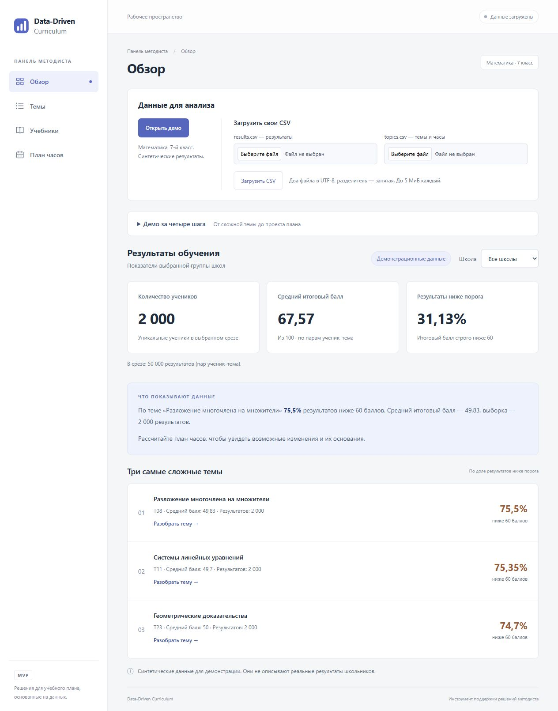
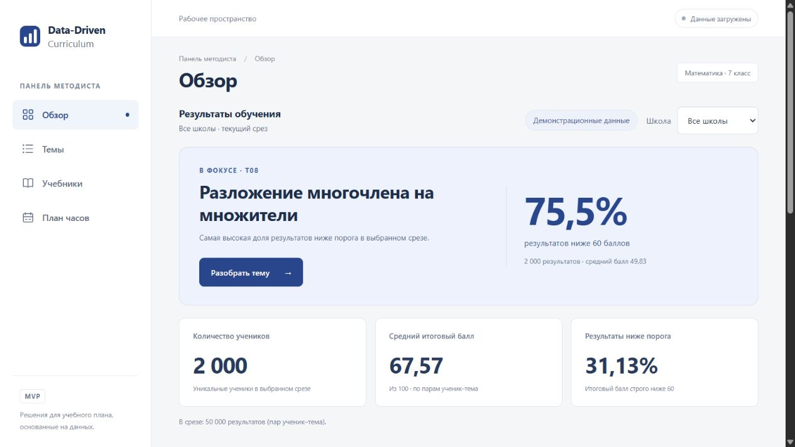
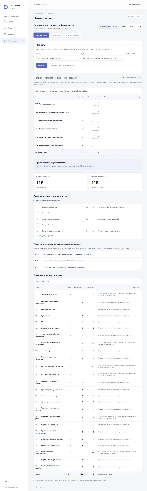
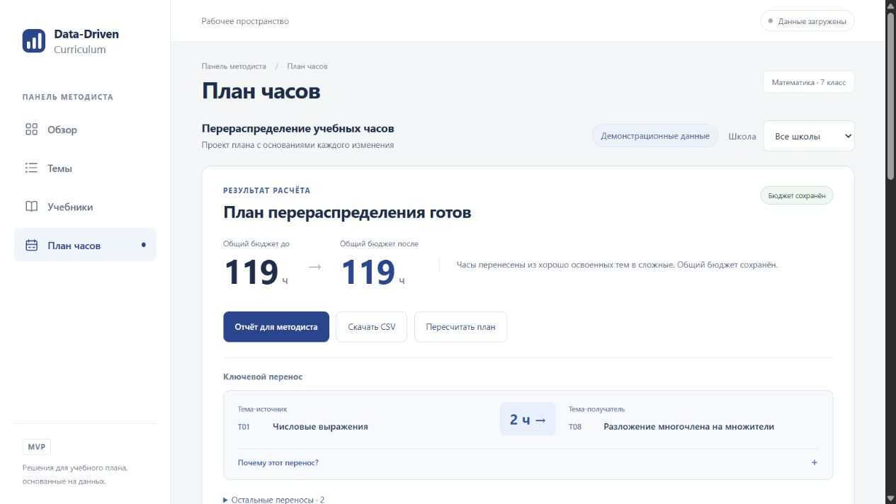

# Обзор и план часов: визуальное обновление

Снимки «до» сделаны на `main` (`0757a8c`), «после» — на `feat/ui-polish`. На всех снимках используются синтетические данные демо. Исходные снимки включают всю страницу, новые показывают первый экран с результатом и следующим действием. Мобильная проверка — CSS viewport 390 × 844.

| Экран | До | После |
| --- | --- | --- |
| Обзор |  |  |
| План часов |  |  |

## Что проверено

- На живом API в браузере: открытие демо → разбор T08 → расчёт плана → перенос T08 → T11 на 1 час → CSV ручного варианта → отчёт.
- До и после автоматического и ручного расчёта — 119 часов. Последний перенос показывает T08: 7 → 6, T11: 7 → 8; эти же значения видны в сравнении и в скачанном CSV. В обоих скачанных CSV по 25 тем и сумма 119 часов.
- В отчёте сохранены исходный, автоматический и ручной бюджеты 119 / 119 / 119, выбранная тема, сравнение учебников и пометка синтетики. Компонент отчёта и его CSS не менялись.
- Фильтр обзора: все школы → S01 → все школы, 2000 → 400 → 2000 учеников. При смене школы в плане предыдущий расчёт и отчёт недоступны, новый расчёт S01 сохраняет 119 часов.
- Раскрытие причины карточкой и клавишей Enter; видимый клавиатурный фокус. Мобильный путь к плану и ручной перенос работают по нажатию, переполнения страницы по горизонтали нет. Таблицы имеют собственную прокрутку.
- `prefers-reduced-motion: reduce` отключает анимации и переходы. Подсветка ручных строк и текстовые значения сохраняются.
- `npm run build` и `npm test` (26 тестов); отдельно покрыты приоритет результата над формой и `no_changes` с объяснением API без выдуманного переноса.

Ограничение: фактическое сохранение PDF не подтверждено. Вызов кнопки печати во встроенном браузере блокирует дальнейшие DOM-команды до Escape. Отдельный диалог сохранения и итоговые PDF-листы нужно проверить вручную. Печатные правила A4, скрытие панели кнопок и повторение заголовков таблиц сохранены; новые стили ограничены `.app-shell` и не применяются к странице отчёта.
